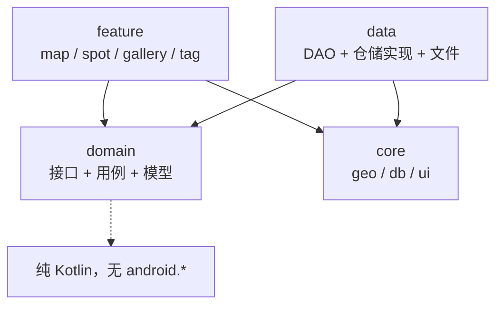
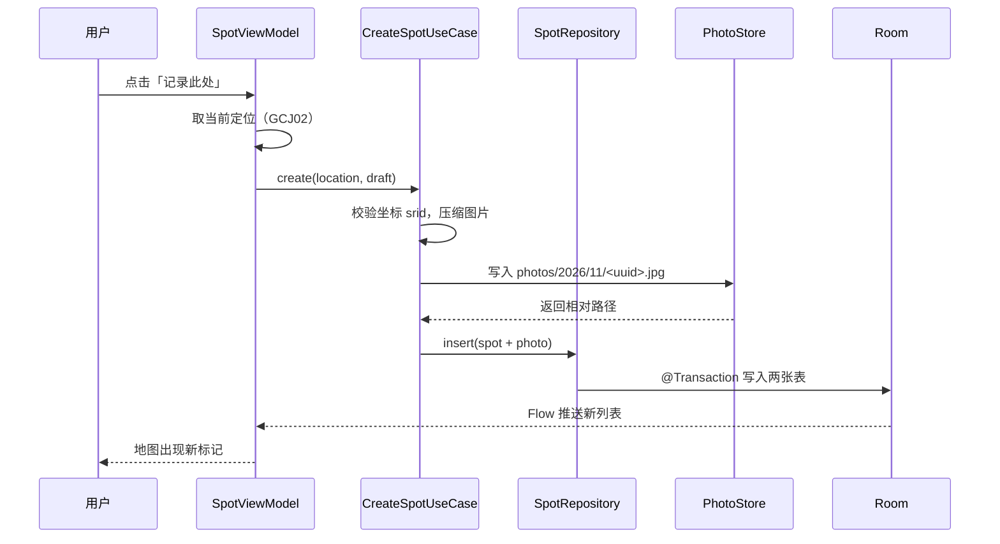
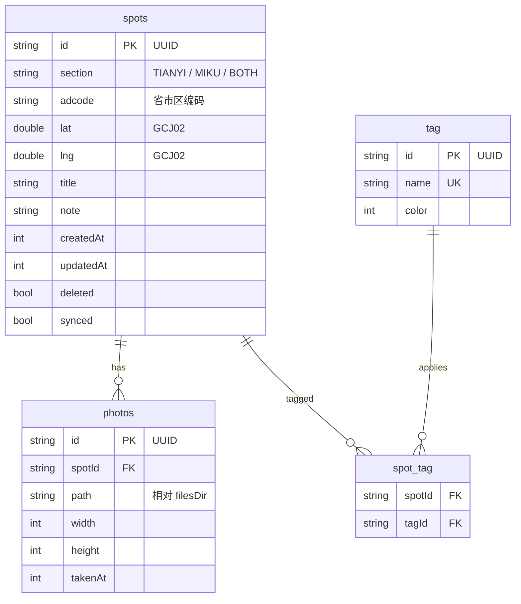

# 架构说明

## 分层



依赖只能从上往下。`domain` 不依赖任何人，这是它能在普通 JVM 单测里跑起来的原因。

## 各层职责

| 层 | 负责 | 不负责 |
|---|---|---|
| `feature` | 界面、交互、`ViewModel`、把状态映射成 UI | 直接读数据库、直接调地图 SDK |
| `domain` | 仓储接口、用例（点亮判定、标签聚合）、领域模型 | 知道 Room / 高德 / Android 的存在 |
| `data` | DAO、仓储实现、文件读写、坐标持久化 | 决定业务规则 |
| `core` | 坐标类型与转换、数据库实例、主题与通用控件 | 认识具体业务概念 |

## 一次「拍照并打点」的完整链路



关键点：**先写文件再写数据库**。如果反过来，数据库里会留下指向不存在文件的记录；反过来则最多留一个孤儿文件，可以用「扫描未被引用的照片」清理。

## 数据表关系



## 板块怎么落地

板块是导航层级，不是标签。用户在两个 tab 之间切换，看到的是两份独立的进度。

> 当前 v0.1 只建了 `spots` 和 `photos` 两张表。`tag` / `spot_tag` 出现在上面的图里是规划，等筛选功能开工时再建，避免现在写了没人用。

```kotlin
enum class Section { TIANYI, MIKU }
```

- `spots.section` 存归属。同台演出记为 `BOTH`，两个板块的统计都算它一份。
- 「依你随行」「因音而遇」只是显示名，放 `strings.xml`。代码里永远用枚举，不做字符串比较。
- 切换板块时查询条件跟着变，**不要在内存里 filter 全量数据**——照片和标记会到几千条。

查询按板块过滤时用 `IN`：

```sql
-- BOTH 在两个板块里都要出现
WHERE section IN (:currentSection, 'BOTH')
```

## 点亮是怎么算的

**不单独存一张点亮表**，直接从 `spots` 聚合。这样「点亮了几座城」和「打过几次卡」永远对得上，不会出现点亮了却没有记录的脏数据。

```sql
SELECT DISTINCT adcode FROM spots
WHERE section IN (:currentSection, 'BOTH') AND deleted = 0;
```

`adcode` 在新建标记时由逆地理编码写入，省市区三级都存（如 `310000` / `310100` / `310101`），渲染时按当前缩放级别取对应层级。

渲染链路：启动时读 `assets/districts/*.geojson`（离线打包的行政区边界）→ 用上面查到的 adcode 集合比对 → 已点亮的填色多边形，未点亮的淡描边。

不在地图初始化时调 `DistrictSearch`。它一次只能查一个行政区，有 QPS 限制，网络不好时首屏会白屏。

以后如果要做「自动记录路过的地方」（后台定位），再单独加 `visited_areas` 表。那时候「打卡」和「路过」是两种数据来源，混在一张表里会互相污染统计口径。

## 地图双引擎

```
MapCanvas
├── BuildConfig.HAS_AMAP_KEY == true  → AmapCanvas（高德 9.8.3）
└── false                              → OsmCanvas（osmdroid 6.1.20 + OSM 瓦片）
```

为什么要两个：

- **高德**体验好、国内瓦片快、中文地名全，但需要 Key，且 Key 绑定包名 + 签名。
- **osmdroid** 不需要任何 Key，`git clone` 完直接能看地图。

开源项目如果只有高德，每个想跑起来的人都得去高德注册、建应用、填包名、算 SHA1。这个门槛会挡掉大部分人。所以规则是：**有 Key 用高德，没 Key 自动降级**，`MapCanvas` 里一个 if 决定。

### 两个引擎的坐标系不一样

这是最容易出错的地方：

| 引擎 | 瓦片坐标系 | 我们存的 |
|---|---|---|
| 高德 | GCJ-02 | GCJ-02 |
| OSM | **WGS-84** | GCJ-02 |

所以 `OsmCanvas` 里每个点画上去之前必须 `point.asWgs84()` 转一次。没转的话整张图上的点会统一偏 300~500 米，而且看起来「差不多对」特别难发现。

这也是当初把坐标系做成类型而不是裸 `Double` 的直接回报：转换只有一个入口，加第二个引擎时不用满地找。

### 共用部分

- `MapIcons.cityDotBitmap` / `arrowBitmap` 返回 `Bitmap`，两个引擎各自包成 `BitmapDescriptor` 或 `BitmapDrawable`。
- `MapIcons.bearing` 收裸 double，不绑任何 SDK 类型。
- 路线箭头都是**预先旋转位图**，不用 marker 的旋转属性（高德 9.x 没有可写的 `rotate`）。

## 同步预留

现在不写客户端网络层，但数据结构已经为同步准备好了：

- `id` 是客户端生成的 UUID，多端并发不冲突
- `updatedAt` 做最后写入优先（LWW）合并
- `deleted` 做软删除，服务端能看到「这条被删了」
- `synced` 做待上传队列

接后端时只需要新增一个 `SyncRepository`，按 `synced = 0` 拉取待推送记录，不需要改表。

冲突策略先定成**字段级 LWW**：同一个 `id` 两边都改过，取 `updatedAt` 大的整条。对单人使用的 App 够用，等真出现多端同时编辑再升级成 CRDT 或操作日志。

## 暂不引入的东西

以下在功能真正需要之前不引入，避免过度设计：

- Hilt / Koin —— 手写 `AppContainer` 就够，依赖关系不超过 20 个
- Entity / Domain 双模型映射 —— 见 `CODE_STYLE.md` 第 5 节
- 多 Gradle 模块拆分 —— 等 `./gradlew assembleDebug` 明显变慢再拆
- Flow 之外的响应式库（RxJava 等）—— 只保留一套
